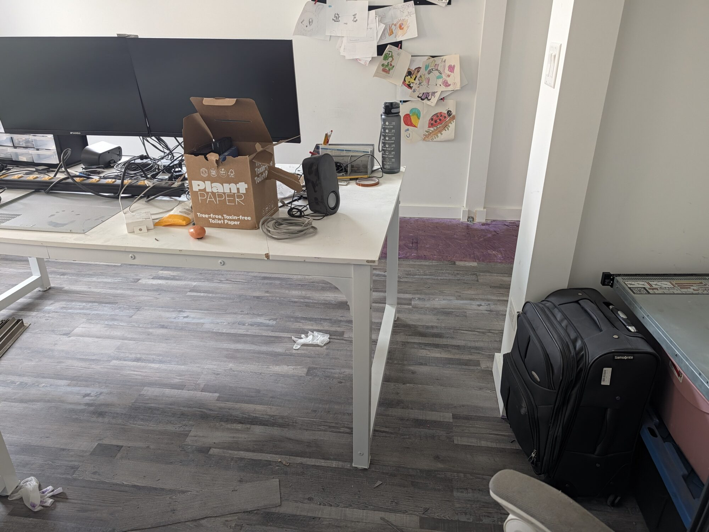

The last post here went up on August 20th. It was about a BeOS descendant showing up as a managed node in AWS Systems Manager, it ended with *"I built it because nobody was going to stop me,"* and then I went quiet for ten weeks.

Nobody stopped me. That's the problem. 😅

This is the catch-up post. There are four things: two operating systems, one remote-desktop client, and one room in my house that currently looks like a crime scene with kids' drawings on the wall. Let's go in that order, because the room is the reason this post exists at all: I can't do anything else in there right now, so I'm writing.

## DeBeOS: Haiku-Graviton grew up and moved out

In August the project was "my Haiku arm64 port for AWS Graviton." It's not that anymore. It's **[DeBeOS](https://github.com/felipedbene/Haiku-Graviton)**, an independent operating system descended from Haiku and BeOS, ARM-first, with Graviton on EC2 as the flagship target and Raspberry Pi 5, Pi 3 and RISC-V on the roadmap.

The name change isn't just branding. **DeBeOS doesn't sync from Haiku anymore.** There's a read-only `haiku-upstream` remote for lineage and reference, and that's it. The debt is real and stays acknowledged: the vast majority of the code is still Haiku's, under Haiku's MIT licence, copyrights intact. But the priorities are mine now, and there's a practical reason it had to be this way: **Haiku's contribution policy effectively rules out AI-assisted patches**, and this tree is built with heavy Claude Code assistance, disclosed on purpose. Pretending that work was headed upstream would have been dishonest to both projects. So it isn't.

Here's the thing about driving an OS hard on real server hardware instead of in QEMU: the metal finds bugs the emulator never will. Some of the ones it found weren't even arm64-specific:

- a **page-writer that never flushed file data**. Remember the bold *"`sync` before you stop a Haiku instance"* in the August post? Draw your own conclusions.
- a **64-bit overflow that stepped the clock backwards every 4 h 53 m**. Time travel, but only in one direction, and only the annoying one.
- a **socket buffer that capped a single TCP stream at 1.6 Gbit/s**.

What works today, all measured on real Graviton hardware:

| | |
|---|---|
| **Boots on** | `c7g`, `t4g`, `c8g`, and **`c7g.metal`**. Bare metal reaches userland now that GICv3 redistributor discovery and per-bridge ECAM are fixed |
| **ENA networking** | jumbo frames at MTU 9001: **4.95 Gbit/s receive, ~4.4 Gbit/s transmit**, single queue. Receive is +403% over MTU 1500 at well under half the CPU per byte |
| **Clean shutdown** | the ACPI power button arrives over the PL061 GPIO; an EC2 stop completes in ~33 s instead of being force-killed |
| **Root auto-grow** | launch onto a bigger EBS volume and BFS grows to fill it on first boot. Crash-safe: `checkfs`-clean with power loss injected at every phase boundary |
| **Native Rust** | `rustc` and `cargo` run *on the box* and build real crates from crates.io. ripgrep builds end to end |
| **Packages** | a lean base image that pulls WebPositive, the Rust toolchain and hundreds of ports on demand from the DeBeOS package repo on S3 + CloudFront |
| **Fleet management** | the SSM-compatible agent from August is baked into the image and auto-registers every instance as a managed node on first boot |

The part I'm proudest of is the boring part. Images come out of a CDK pipeline that cross-builds, imports, registers the AMI, **boots it on real hardware and measures it**, and only then offers it for promotion. If a candidate won't boot, won't negotiate MTU 9001, loses throughput, or doesn't survive a power cycle, it fails the gate. And the repo's `graviton/docs/` directory keeps the **disproven hypotheses on the record** next to the ones that survived. If an AI helped me reach a wrong conclusion, the wrong conclusion stays in the docs with a correction under it. That's the deal.

(And yes, the CPU still shows up as 0 MHz in places. Some jokes you keep.)

## RenkuOS: the other sibling

While DeBeOS was going ARM-first and cloud-shaped, a different BeOS-descendant project showed up with the opposite focus: **[RenkuOS](https://github.com/RenkuOS/Source)**, *"an open-source operating system that specifically targets personal computing, inspired by BeOS and based off of Haiku."* The goals are sensible defaults, clean code, and a unified desktop. The tier-1 targets are x86 and x86_64, and there are **nightly ISOs** already (build 69 dropped this morning).

What pulled me in is in the [governance docs](https://github.com/RenkuOS/PlanAndGovernance). The project's defining choice is that **machine-assisted contributions are welcome**, and it takes that seriously enough to put **CI before features**: gating from day one, before the repo even opens for pull requests. Their reasoning is the most honest sentence I've read in an OS project this year: the characteristic failure of machine-generated code is that it's *plausible and wrong*, and automation is the only defence that scales past two or three reviewers. That's exactly right, and it's exactly why DeBeOS has a boot-and-measure gate.

So I've been contributing. About twenty commits so far, mostly in the places where my DeBeOS scars transfer directly:

- **TCP**: retransmitting the SYN-ACK on our own timer and on a duplicate SYN, keeping silly-window avoidance on `TCP_NODELAY` sockets, consistent errno after a reset, and making `tcp_shell` complete a handshake again
- **network stack / AF_UNIX**: a socket-abort race, taking the stack-interface reference *before* publishing socket FDs, and `SCM_RIGHTS` behaviour plus a test for it
- **ThinkPads**: TrackPoint buttons that stopped getting stuck held, pass-through commands driven asynchronously, and **middle-button scrolling** (the one feature every ThinkPad person checks first)
- **PCI / graphics**: enabling bus mastering on upstream bridges, and a device ID for Haswell GT2 Server (HD P4600) in `intel_extreme`

Two descendants of the same 1990s operating system, one aimed at Graviton instances and one aimed at your ThinkPad, both openly built with AI help and both betting that strong CI is what makes that work. Different targets, same family. 🖖

## DeBeOS-RDP: the client is the renderer

The August post ended with a full BeOS-descendant desktop drawn into a Chrome tab through websockify. That worked, but it was riding on a reference JavaScript client, and I wanted a real one. That became **[DeBeOS-RDP](https://github.com/felipedbene/DeBeOS-RDP)**.

The first thing it taught me changed the whole plan: **`app_server`'s remote protocol is not a framebuffer protocol.** `app_server` holds no framebuffer at all; `FrontBuffer()` returns `NULL`. It ships the drawing calls themselves ("stroke this rect," "fill this region," "draw this string," "play back this Bézier path"), so it's much closer to X11 or RDP drawing orders than to VNC. **The client is the renderer.** There's no full frame to decode and no dirty rectangles to patch. Instead you reimplement roughly 70 drawing ops, 11 drawing modes, 8×8 stipple patterns, 5 gradient types, 8 bitmap colour spaces and path playback. And the server *blocks waiting for the client to measure strings*, so text layout has to happen on your side too.

Some of my favourite lessons:

- **Every colour was wrong, and the tests said everything was fine.** The first client was Swift/AppKit, and `CGColor(red:green:blue:alpha:)` quietly builds colours in Generic RGB (gamma 1.8). Drawing those onto a DeviceRGB canvas colour-matches them, so a desktop background of `(51,102,152)` landed as `(64,116,163)`. The tests asserted things like `px.r > 200`. Now they assert exact values.
- **The reference client was the wrong oracle.** Comparing against the JS demo only validates plain fills. Re-deriving the drawing model from `app_server`'s own sources found defects in code that looked finished.
- **Bandwidth is upside down.** A `RP_FILL_RECT_COLOR` is 30 bytes; a full-screen bitmap is 8.3 MB. Don't optimise the vectors, avoid the bitmaps. A session-long zstd stream under the framing brings bitmap-heavy traffic down **40× while scrolling Hacker News and 310× while typing**.
- **Text, pixel for pixel.** The image ships FreeType 2.6.3 with only the v35 TrueType interpreter and no LCD filtering, so the client vendors exactly that and runs it through a port of `app_server`'s own text path. Against the server's own renderer, every text scene is **pixel-identical**. The host's modern FreeType differs in 37,517 pixels.

The Swift client is now frozen as a read-only [prototype](https://github.com/felipedbene/DeBeOS-RDP-swift). Keeping two independent renderers of one protocol meant implementing every wire change twice and watching them drift until neither could vouch for the other. The real client is **portable C++20**: a platform-neutral protocol core, a software renderer, SDL2 frontends for Windows, macOS and Linux, an X11 frontend, a headless PNG frontend for tests, and as of last month a **QUIC transport** alongside the websocket one, with a loss benchmark under `tc netem` to prove it earns its place. It auto-reconnects with backoff and handles resolution changes without dropping the session. It also builds on Haiku itself, including 32-bit x86_gcc2, so a BeOS descendant can remote into a BeOS descendant. Obviously. 🙃

## The office, and two servers out the door

And now the real reason for the silence:

That's the office, mid-renovation. Purple floor protection in the doorway, a box of parts that used to be a tidy shelf, a single latex glove on the floor (evidence of something), and the gallery of my kids' drawings, which survived everything and will be the first thing back on the new walls. Bottom right, sitting on a pink storage bin like it's waiting for a bus: **the Dell**.

The Dell is the cover photo of this post, and it's xeon2socket's parent, in homelab-lineage terms: the PowerEdge that **xeon2socket replaced**, and it's spent the months since on a shelf, doing what retired 1U servers do best: collecting dust. Very Flávio Bolsonaro of it, honestly: lose the election, ignore the order to hand over your passport, and quietly leave the country. He at least made it to Miami. The Dell made it to the shelf by the door. The renovation just upgraded the dust to drywall grade. When you have to wipe a server before you can photograph it for the listing, that's the universe telling you something.

And xeon2socket itself? If you've been reading for a while, you know it. It was a Kubernetes worker for years. It ran Frigate and held Longhorn replicas. In May it became the TrueNAS box in the [$400 sovereignty stack]() post: 94 GB of ECC RAM repurposed as ZFS ARC, a 27 TiB pool, ConnectX-3 on InfiniBand. In the telenovela it was already listed as *"deceased, don't even mention him."* That was a joke. It's not a joke now: xeon2socket is decommissioned. 180 W at idle, no AVX-512, a PCIe 3.0 ceiling. It served honourably, but its environmental record was indefensible: four years of campaign promises about efficiency, and it never once saved energy. Its whole platform was burning watts. So for the next term I'm betting on the two greener candidates: **Lula or the Cloud**. One promised to protect the Amazon, the other *is* Amazon, and at least that one bills me only for what I use. 🌱

**Both of them are going up on Facebook Marketplace**, the replacement and the machine it replaced, in the same listing week. Somebody out there wants an iDRAC'd PowerEdge and 94 GB of ECC RAM for cheap (despite the hostname, xeon2socket has been single-socket for a while; buyer beware), and I hope they love them as much as I loved complaining about the power bill. 🫡

This isn't a swap for something newer. **I'm downsizing.** What that looks like, what stays, what goes, and where 27 TiB of data ends up is a whole post of its own, coming soon. For now I'll just point at a pattern across this catch-up: the work kept moving *off* the basement hardware and *onto* things I can measure and throw away. Graviton instances that boot, get measured, and get terminated; CI that gates every change; nightly ISOs. The 180 W idle boxes ran out of excuses.

## What's next

- **DeBeOS**: Stage 1, self-sufficiency. Toolchain reliability under heavy native builds is the active front, then the package ecosystem, then Raspberry Pi and RISC-V.
- **RenkuOS**: more networking and hardware fixes, wherever a ThinkPad or a TCP state machine misbehaves.
- **DeBeOS-RDP**: getting the C++ client to where someone who isn't me can install it and just connect.
- **The office**: walls, floor, then the drawings go back up. In that order, I'm told.

I'll try not to go ten weeks between posts again. But if I do, you know where to look: there's probably a pull request open somewhere. 🚀

---

## Disclaimer

**Built with AI.** DeBeOS, DeBeOS-RDP and my RenkuOS contributions are built with heavy AI-assistant help (agentic pair-programming with Claude Code), and so is a fair amount of this post. Every repo says so up front, and the git history doesn't hide it. If that's a dealbreaker for you, I understand.

**Not affiliated.** DeBeOS isn't affiliated with or endorsed by the Haiku project, and neither am I. It's an independent descendant under Haiku's own licence. RenkuOS is a community project I contribute to; I don't speak for it. Nothing here is affiliated with or endorsed by Amazon.

**Experimental.** These are unfinished operating systems and an unfinished remote-desktop client. They will misbehave. Don't point them at anything you love.
